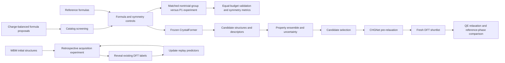

I recommend a **one-day research prototype with three evidence streams**: a retrospective DFT-label experiment for uncertainty-aware acquisition, a controlled comparison of symmetry-guided sampling, and a small fresh DFT validation study. Composition exploration remains part of the generation pipeline. The aim is a complete, reproducible discovery workflow; obtaining a genuinely new stable material is an experimental outcome rather than a promised deliverable.

**Execution status, 22 October 2026:** Phases 1–5 are complete. All five paired replay seeds ran under the unchanged frozen protocol: quality ranking averaged 41.2 near-stable historical records per 50 queries, versus 29.4 for the full method, which retrieved fewer hits in every seed. Matched primary control sampling and all six default composition cohorts are complete. No new-formula output passed the exact-cell gate (0/48); twelve larger-cell reduced-composition matches remain diagnostic exclusions. All 11 selected CHGNet calculations converged, using ten new launches and one verified cached MgO result: four symmetry selections, four prototype baselines and three eligible same-composition references. The selected nontrivial-arm outputs are lower in model energy than P1 by 356.879 meV/atom for MgO and 55.806 meV/atom for TiO2. Each comparison has one structure per arm, MgO uses the supplementary pool, and the nontrivial outputs match known phases; these results do not establish an architectural causal effect. Fresh QE previously validated the known MgO control and compatible CaO/MgO anchors. Phase 5's deterministic MgO perturbation reached its 900-second internal time limit before terminal electronic/ionic acceptance; the frozen rules allowed no continuation or sensitivity probes, so that additional robustness check remains incomplete. No primary CaMg2O3 candidate or complete hull was evaluated; accepted source-reference coverage remains 2/161. See the [Phase 1 report](reports/phase1_report.md), [Phase 2 report](reports/phase2_report.md), [Phase 3 report](reports/phase3_report.md), [Phase 4 report](reports/phase4_report.md), [Phase 5 report](reports/phase5_report.md), [current readiness](artifacts/phase5/readiness.json) and [cumulative budget ledger](artifacts/budget_ledger.json). Conservative charges consume 96/128 structure slots, leaving 32; 19/40 CHGNet launches are charged, leaving 21, with 159.01 seconds of cumulative CHGNet walltime. Cumulative QE walltime is 2,558.92 seconds, leaving 19,041.08 seconds. All overall caps and original phase windows remain binding. No new stable material has been established.

The chosen topic remains **Uncertainty-Aware, Symmetry-Constrained Transformer for Out-of-Distribution Crystal Discovery**. The prototype addresses three narrower questions:

1. Does uncertainty-aware acquisition retrieve more near-stable oxide structures than predicted-quality ranking alone under an equal retrospective label-query budget?
2. With the same frozen generator and attempted-sample budget, does conditioning on a compatible nontrivial space group produce better candidates than P1 conditioning?
3. Can a selected generated candidate be DFT-relaxed and assessed against consistently calculated competing phases within a bounded local-compute budget?

A prototype does not need to outperform a foundation model. It needs clear controls, a working pipeline and conclusions supported by the completed calculations. Small or negative results remain useful.

**The local hardware supports the prototype, with Phase 1 pilot runtimes now measured.** Checks identified an **RTX 3060 Ti with 8 GB VRAM**, an **Intel i5-12600 with 12 logical CPUs**, and approximately **32 GB RAM**. WSL is not installed. The verified arrangement is CPU CrystalFormer sampling, CPU uncertainty modelling, GPU CHGNet relaxation, and native Windows CPU Quantum ESPRESSO calculations. CPU sampling and DFT share resources, so their full-speed runtimes cannot be assumed to overlap. Native Windows JAX supports CPU execution rather than NVIDIA GPU execution. [JAX platform support](https://docs.jax.dev/en/latest/installation.html)

The decisions for this prototype are:

| Component | One-day choice | Purpose |
|---|---|---|
| Main material family | Binary and ternary metal oxides, at most 20 atoms per evaluated cell | Sufficient labelled examples and manageable structure sizes |
| DFT subset | One tractable chemical system; preferably 2–10 atoms per candidate cell, with affordable reference phases | Concentrate genuine physics validation on a small shortlist |
| Retrospective target | Released WBM signed distance to a fixed MP reference hull | Test acquisition against existing DFT outcomes |
| Retrospective success threshold | ≤0.05 eV/atom, called near-stable; ≤0 eV/atom reported separately | Avoid equating near-stability with strict stability |
| Generator | Frozen CrystalFormer v0.6 multitask checkpoint | Formula-conditioned, symmetry-controlled generation |
| Composition search | Screen up to 3,000 formulas; target six new-to-reference proposals plus two reference controls | Explore beyond supplied compositions without promising discovery |
| Conditional composition stretch | Eight new-to-reference proposals plus two controls | Enabled only after the main experiments and DFT lane are secure |
| Uncertainty model | Five bootstrapped ExtraTrees regressors, approximately 128 trees each | Fast CPU fitting and controlled acquisition ablations |
| Symmetry comparison | Two reserved reference-control formulas, fixed nontrivial group versus P1 | Test conditioning/sampling policy inside one frozen model |
| Genuine DFT engine | Quantum ESPRESSO on CPU, subject to installation and numerical pilots | Produce fresh electronic-structure evidence |
| Core replay budget | 50 simulated DFT-label queries per policy and seed | Equal incremental acquisition budget |
| Fresh sampling ceiling | 128 total attempted structures across all branches | Include pilots, invalid outputs and optional attempts |
| CHGNet ceiling | 40 relaxation attempts and four cumulative hours | Shared by pilots, symmetry comparisons and candidate pre-relaxation |
| Fresh DFT ceiling | Six cumulative hours of QE job walltime, with all numerical work ending by hour 18 | Include pilots, references, candidates, convergence checks and failures |

**The architecture connects the workflow while keeping the evidence distinct.**



The WBM experiment measures acquisition performance. The symmetry experiment measures the effect of a sampling policy. Fresh DFT assesses selected candidates. These results cannot be combined into a claim that the full generator architecture improves newly DFT-confirmed discovery unless the relevant controlled evidence is actually collected.

**Phase 1 must establish the software path before scaling.** Use isolated environments rather than changing the base Python installation. Record source revisions, package locks, checkpoint hashes, executable hashes, pseudopotential hashes and command lines.

For CrystalFormer, use source revision `31bb734a3fd006af49a021921839061e6184cbf1` and multitask checkpoint `alex20s/multi/epoch_044000.pkl` from Hugging Face revision `b203f4273158d95b49b60a13433bf1dcc4ccf5d9`. The model card specifies about 13.8 million parameters, 16 layers, eight heads and width 256. Its approximately 1.7 million Alexandria-derived training structures are limited by Wyckoff-site count, not by a 20-atom limit. Apply our evaluated-cell atom cap independently. [Pinned model card](https://github.com/deepmodeling/CrystalFormer/blob/31bb734a3fd006af49a021921839061e6184cbf1/MODEL_CARD.md)

The tested generator environment is Python 3.11.14 with `jax==0.7.2`, `jaxlib==0.7.2`, `dm-haiku==0.0.15`, `optax==0.2.6`, `pyxtal==1.1.1` and `numpy==2.4.6`. Phase 1 resolved and verified this environment through real pretrained sampling; exact versions are frozen in [generator-lock.txt](requirements/generator-lock.txt). The separate analysis/CHGNet environment uses `chgnet==0.4.2`, pretrained model `0.3.0`, `torch==2.6.0+cu124` and `numpy==2.2.6`; CPU and CUDA relaxation pilots passed. Its full versions are frozen in [analysis-lock.txt](requirements/analysis-lock.txt). [Repository dependencies](https://github.com/deepmodeling/CrystalFormer/blob/31bb734a3fd006af49a021921839061e6184cbf1/pyproject.toml), [CHGNet package](https://pypi.org/project/chgnet/0.4.2/)

For DFT, first test the QMatSuite native Windows Quantum ESPRESSO 7.5 distribution. It is a **third-party build**, not an official upstream QE binary. Verify its release checksum and executable operation; availability alone is not a runtime result. Avoid making a new WSL installation or a source compilation a day-one prerequisite. [Windows distribution](https://github.com/QMatSuite/quantum-espresso-windows-exe)

The initial sampling pilot uses eight attempts at one predeclared reference control under its nontrivial-group arm. These count toward that arm's primary allocation only if they satisfy the frozen production protocol, including the correct checkpoint and sampling settings. Otherwise retain them as engineering attempts inside the global ceiling and collect the primary comparison separately. Reserve that chemical system before the predictor splits are frozen. Check checkpoint loading, conversion to complete structures, stoichiometry, expanded atom counts, measured symmetry and runtime. The current entry point can continue from randomly initialized parameters when a checkpoint is missing, so output files alone do not establish a successful pretrained run. [Entry point](https://github.com/deepmodeling/CrystalFormer/blob/31bb734a3fd006af49a021921839061e6184cbf1/main.py)

Measure first compilation, subsequent batches and a change of formula separately. Reuse a loaded generator and fixed batch shapes where possible; verify rather than assume compilation reuse. Test CHGNet device placement and relaxation on a small reference. Test QE with a known small phase, such as MgO, using documented pseudopotentials and numerical settings. A known-phase engine test is a calibration/control calculation, not a discovery.

**The WBM benchmark remains the main quantitative uncertainty experiment.** Use the published unique-prototype population, oxygen-containing compositions with two or three elements, and at most 20 sites. A prior read-only audit found **8,294 eligible metal-oxide records across 1,866 chemical systems**, including **1,934 within 0.05 eV/atom** of the reference hull. These are dataset counts, not model performance.

To reproduce that population, exclude any nonoxygen element in {H, B, C, N, F, Si, P, S, Cl, Ge, As, Se, Br, Sb, Te, I, At, Ts, He, Ne, Ar, Kr, Xe, Rn, Og}. This is the operational family definition used in the audit. Rerun the count against the pinned files and report any discrepancy rather than forcing the old count. The unique-prototype flag defines this retrospective benchmark population; it is not a pre-validation filter that establishes novelty for new samples.

The WBM summary and initial-coordinate downloads are approximately 62 MB compressed. Software, weights, pseudopotentials and additional reference catalogs require separate downloads. Use the official file registry to obtain and checksum the files. [Registry](https://raw.githubusercontent.com/janosh/matbench-discovery/main/matbench_discovery/data-files.yml)

Use `e_above_hull_mp2020_corrected_ppd_mp` as the released regression target. It is signed distance to a fixed historical MP reference hull, so negative values are meaningful and must remain intact. Report near-stable hits at ≤0.05 eV/atom and on/below-reference-hull hits at ≤0 eV/atom separately. Do not rebuild this oracle using unrevealed candidate labels or mix it with the new QE reference convention. [WBM methodology](https://raw.githubusercontent.com/janosh/matbench-discovery/main/data/wbm/readme.md)

MP-20 is not the primary instability-screening benchmark: its original curation already restricts hull energy below 0.08 eV/atom, making a ≤0.1 eV/atom success threshold all-positive. [MP-20 curation](https://raw.githubusercontent.com/txie-93/cdvae/main/data/mp_20/README.md)

The predictor uses composition fractions, elemental-property statistics, initial space group/Wyckoff information, and inexpensive initial-coordinate descriptors such as volume per atom and distance statistics. Exclude relaxed volume, relaxed symmetry, band gap, formation energies and initial-to-final changes. Align IDs with initial coordinates before extracting features. Use the same descriptor function for WBM and fresh candidates.

Five independently bootstrapped ExtraTrees regressors produce the mean prediction and ensemble disagreement. Calibrate disagreement using residuals on the fixed calibration population and report interval coverage and width on evaluation data. Freeze the uncertainty floor, scaling, diversity distance, feature normalization, acquisition coefficients and tie-breaking before inspecting candidate outcomes. Calibration under one shift does not guarantee coverage under arbitrary OOD chemistry.

| Replay partition | Proposed size | Role |
|---|---:|---|
| Initial training | 2,000 structures | Fit starting predictors |
| Calibration | 400 structures | Calibrate uncertainty and fix settings |
| Hidden candidate pool | 2,000 structures | Simulate incremental DFT queries |
| Fixed untouched evaluation | 3,418 structures per frozen seed | Error, uncertainty/error association and interval coverage/width; never queried or fitted |

Allocate whole chemical systems, defined by sorted element sets, to disjoint groups. Candidate elements should occur individually in training, while their complete combinations are withheld. Counts are targets subject to group allocation. Reserve **all fresh-demonstration chemical systems from training and calibration across every seed**, including the Phase 1 control and any new formula reserves admitted later.

**Phase 2 freeze:** seeds20261022–20261026 each meet the2,000/400/2,000 targets exactly without splitting chemical systems. All78 binary/ternary oxide systems in the fixed12-metal palette are reserved, excluding476 eligible rows. Every training split covers all68 individually occurring nonreserved elements. The3,418 rows under the existing `unused` partition key are the fixed untouched evaluation set. Their labels are evaluator-only and cannot affect acquisition or fitting; queried rows never enter these out-of-sample metrics. Signed historical oracle labels are saved separately from the408-dimensional initial-only feature archive.

The 2,400 initial labels are a shared starting resource, separate from 50 additional simulated queries. Compare random, predicted quality only, quality plus diversity, uncertainty only, and the full method on identical splits and starting resources. Use five batches of ten queries and five paired seeds. The full method allocates seven conservative exploitation choices and three optimistic exploration choices per batch, with predeclared scores based on the mean and calibrated disagreement and the same stated diversity rule.

Only the selected labels are exposed to each policy, followed by refitting of its small predictors. Retain all seeds and outcomes. Report hits versus queries, hits and precision at 50, reference-hull hits, chemical-system coverage, prediction error, uncertainty/error association and coverage. These are retrospective label queries, not newly executed DFT calculations.

For fresh candidate selection, freeze **one initial calibrated ensemble snapshot and seed before any replay outcomes**, rather than choosing the best replay seed or an adapted model that has acquired labels from the relevant chemistry. Fresh DFT results are not automatically fed back into the WBM head: their targets and reference energies must first be reconciled.

**Composition exploration targets breadth, with deeper validation reserved for a small subset.** Screen up to 3,000 unique charge-balanced formulas from a fixed metal palette, explicit oxidation states and integer stoichiometries. Deduplicate reduced formulas, check named versioned reference catalogs, and freeze a label-blind ranking plus reserves. Target **six new-to-reference formulas plus two known reference controls**. Eight new-to-reference formulas plus two controls remain a conditional stretch, not a required outcome.

A prior CPU-only arithmetic check enumerated **1,359 reduced ternary oxide formulas with at most 20 atoms** in approximately 0.005 seconds. It used Mg/Ca/Sr/Ba/Zn at +2, Al/Ga/In at +3, Ti/Zr/Hf at +4, Sn at +2 or +4, and oxygen at -2. It did not check catalogs, generate structures or validate materials. The project palette must also satisfy training-element coverage and held-out-system rules.

**Phase 2 composition freeze:** the full enumeration contains1,372 formulas including13 binary and1,359 ternary. Checking the full WBM composition list and MP2022 snapshot leaves1,135 absent from both. The six label-blind selections are **SnSrO2, BaSnO2, CaMg2O3, Mg2SrO3, Ca2ZnO3 and Ca2SrO3**, with eight reserves. Fresh generation uses fixedSG2, exact reduced cells of four or six atoms for the defaults, and frozen seeds/multiplicity witnesses. The matched known controls are Mg4O4/SG225 and rutile Ti2O4/SG136 versus P1. Catalog absence is scoped to the checked releases and does not establish global novelty or generator-training absence.

Charge balance is a useful plausibility screen, not a stability result. With Mg at +2 and O at -2, the binary Mg–O enumerator gives only reduced MgO; it does not generate novel Mg–O stoichiometries. A Mg–O DFT study could investigate structures at a known composition. Peroxide or other chemistry would require an explicitly changed screen and appropriate competing phases, rather than a silent expansion of assumptions. [Oxidation-state screening](https://smact.readthedocs.io/en/latest/tutorials/oxidation_states.html)

Freeze the actual catalog names, versions and coverage in Phase 2. Prefer the full WBM composition list and an accessible MP composition snapshot over the filtered oxide benchmark alone; verify their schemas and completeness. The public MP structure-entry archive in the registry can provide reference geometries, but its stored energies must not be used as substitutes for compatible new QE energies. If a required catalog or reference inventory cannot be obtained, record its absence and scope the claims accordingly.

New-to-reference means absent from the checked snapshots. It does not establish absence from all literature, all databases or CrystalFormer's training data. Check structures again after relaxation, because a distinctive initial proposal can become a known phase. If fewer than six qualifying compositions or valid structures survive, report the actual count with the controls. Zero survivors is valid.

Formula proposal by enumeration followed by CrystalFormer is **constraint-based composition proposal plus transformer structure generation**. An optional 16–32-attempt masked formula-free branch would let the transformer choose compositions, but it remains disabled by default. It may use only leftover sampling capacity after the replay, symmetry comparison and DFT lane are secure, and adds no CHGNet or DFT allocation. It is a separate exploratory cohort. [Sampler implementation](https://github.com/deepmodeling/CrystalFormer/blob/31bb734a3fd006af49a021921839061e6184cbf1/crystalformer/src/sample.py)

**The symmetry experiment is a matched sampling-policy comparison.** Predeclare two known reference-control formulas, preferably with 4–10 atoms in the matched evaluated cells. For each, choose one compatible nontrivial space group from prototype metadata without consulting target energies. Compare that fixed group with P1 using the same frozen checkpoint. Do not interchange this design with a changing top-K group mixture.

| Symmetry arm | Setting | Shared controls |
|---|---|---|
| Nontrivial group | Fixed compatible space group greater than 1 | Same formula, exact element counts in the evaluated cell, checkpoint, temperature/top-p, seed schedule and attempted-sample count |
| P1 | `--spacegroup 1` | Identical acceptance and downstream relaxation settings |

The primary generation comparison uses the **first eight attempts per arm per formula: 32 attempts total**. Include formula mismatches, invalid geometries and conversion failures in the denominator. Compare exact expanded cell counts, not only reduced formulas, since different formula-unit counts have different computational costs. Detect actual symmetry using one frozen tolerance; P1 conditioning can still produce higher emergent symmetry.

Primary outcomes are valid unique composition-correct outputs per attempt and walltime. Secondary outcomes are relaxation success, actual symmetry before/after relaxation, and relative CHGNet energies within identical composition. Select up to four valid unique candidates **randomly within each arm**, with the seed fixed before their relaxation energies are known. Do not apply uncertainty ranking to one arm only.

For each control formula use the balanced relaxation quota `q = min(4, valid_unique_nontrivial, valid_unique_P1)` in both arms. Aim for at least two candidates in each arm for a minimally informative energy comparison; if that is not achieved, report the generation result and the shortage. A zero quota yields no balanced energy comparison. Use the same unconstrained CHGNet relaxation procedure for both arms.

Balanced top-ups may help obtain usable structures, but their yield is supplementary: they do not replace the fixed first-eight primary denominator. Top up both arms of a control equally in fixed batch increments and report the additional attempts separately. Complete any top-ups before the final seeded random selection for relaxation; do not redraw candidates after observing relaxation energies or add replacements outside the 16-slot symmetry allocation. Relaxation comparisons that use topped-up pools must be labelled as supplementary. No formula or group is replaced because its validation energies are disappointing.

This tests the practical effect of conditioning on a nontrivial group versus P1. Both arms retain CrystalFormer's space-group/Wyckoff-aware architecture and learned group-dependent behaviour. A positive result supports that sampling policy under this protocol, not a universal architectural advantage. A matched architecture/training ablation would require comparable generators trained with and without the prior. They could be small models, but training that pair is outside this prototype. The two known controls also do not establish symmetry benefits on novel compositions.

A paired symmetry-preserving versus free relaxation test is a possible later experiment, not an extra day-one requirement. ASE supports it, but preserving symmetry can retain a higher-energy phase, so symmetry retention alone is not evidence of stability. [ASE constraints](https://docs.ase-lib.org/ase/constraints.html#the-fixsymmetry-class)

**The shared generation budget accommodates both composition breadth and symmetry controls.**

| Initial attempted samples | Default | Conditional stretch |
|---|---:|---:|
| Two controls × two symmetry arms × eight attempts | 32 | 32 |
| New-to-reference formulas × eight attempts | 48 for six formulas | 64 for eight formulas |
| Deterministic prototype-substitution candidates, counted once | 4 | 4 |
| Initial total, including pilot and prototype candidates | 84 | 100 |
| Remaining capacity below the global ceiling | 44 | 28 |
| Global attempted-sample ceiling | 128 | 128 |

The84/100 totals and44/28 remaining capacities assume the sampling pilot can be reused under the production protocol. These totals distinguish80/96 CrystalFormer draws from four deterministic prototype candidates. The four originals were prepared and ledgered in Phase2; conversions/copies/reuse do not create more attempts. Nonreusable engineering attempts also consume the ceiling and reduce actual headroom; the ledger determines whether a top-up or stretch can run.

**Current Phase 5 accounting:** the completed program has 80 primary CrystalFormer draws, eight separately labelled supplementary MgO draws, four prepared prototype candidates and four un-emitted engineering charges: **96 charged slots, leaving 32**. Phase 5 adds no generation charges; its ten new CHGNet launches plus one cached reuse bring cumulative launch charges to **19/40, leaving 21**. The original nominal table excludes engineering and supplementary overhead. Primary first-eight denominators remain fixed. The conditional composition stretch is disabled because the core adequacy gates fail; remaining capacity alone does not enable it. See the [Phase 4 accounting and gate record](reports/phase4_report.md) and [Phase 5 closure](reports/phase5_report.md).

Remaining capacity covers balanced top-ups, eligible reserve formulas, bounded retries and any explicitly enabled formula-free attempts. Every emitted or failed sample attempt counts; using a larger batch than requested must not hide overshoot. Prefer fixed batch sizes that fit the allocation.

Use a common geometry/stoichiometry validation pipeline and record every rejection reason. The 20-atom cap applies after symmetry expansion. Deduplicate with frozen tolerances. For the new-formula shortlist, the fixed fresh selector ranks valid structures by predicted quality, uncertainty and diversity. Its scores are screening estimates, not new stability labels.

**CHGNet is a screening and pre-relaxation stage, with one shared budget.** Use package 0.4.2/model 0.3.0 and initially cap each relaxation at 200 steps with a 0.05 eV/Å force target. Record whether convergence is actually achieved. This MLIP threshold does not define DFT acceptance. [CHGNet capabilities](https://chgnet.lbl.gov/)

| CHGNet allocation | Maximum relaxation attempts |
|---|---:|
| Phase 1 launches: four rejected before model execution plus four successful pilots | 8 |
| Symmetry comparison: MgO up to one unique per arm; rutile up to four per arm | 10 |
| New-composition shortlist and DFT pre-relaxations | 12 |
| Prototype-substitution comparisons on a predeclared subset | 4 |
| Same-composition reference structures, where available | 4 |
| Explicit retry contingency within remaining budget | 2 |
| Total ceiling | 40 |

The ceiling is **40 attempts and four cumulative hours of CHGNet relaxation runtime**, including Phase 1 pilots, early DFT pre-relaxations and later runs. Timeouts, retries and nonconvergence consume the allocation. Cached identical calculations count once as compute but all experimental selections remain recorded. Pilot results do not become extra nonrandom symmetry samples; reuse is allowed only if their independently fixed selection and eligibility satisfy the comparison.

At the six-formula target, the shortlist allows up to two distinct structures per new formula. At an eight-formula stretch, first seek one per formula, then allocate the remaining four slots by the frozen ranking and diversity rule. Additional pre-relaxations of these candidates cannot be charged to an invisible DFT-preparation budget. Missing formulas or templates leave unused slots. Equalize symmetry-arm quotas when yields differ.

The former random/quality/full three-policy comparison on all fresh formulas is removed. Acquisition is tested in the larger WBM replay; fresh relaxation resources now serve the symmetry comparison and DFT shortlist. Prototype results are descriptive and must be compared only on the same predeclared formula subset.

Normalize CHGNet energies to eV/atom before within-composition comparisons, recording the total energy and actual atom count where the API returns total energy. Never compare unnormalized total energies for cells containing different numbers of formula units. Where no known reference crystal exists, relative polymorph energies require at least two distinct relaxed structures; one result provides no polymorph ranking. Four reference slots do not anchor every proposed formula. Do not subtract CHGNet energies from a DFT hull or equate relaxation convergence with thermodynamic stability.

**Fresh DFT is now an explicit prototype objective.** It assesses **one or two selected structures, preferably at one composition**, allowing reference-phase calculations to be shared. Prefer a qualifying new-to-reference candidate if its cells and reference inventory fit the timing pilot. A known composition can also yield a structural proposal; if it relaxes into a known phase, report recovery rather than discovery. No new stable outcome is guaranteed.

Select the chemical system using reference coverage, cell sizes, electronic simplicity and measured tractability. Freeze the system, catalog-derived competitor inventory, candidate ranking and reserves before candidate DFT outcomes are known. Include elemental endpoints and phases in relevant subsystems, not merely an attractive same-composition reference or a convenient decomposition reaction. Missing or expensive phases cannot be silently dropped while retaining an unrestricted hull claim.

**Phase 2 DFT freeze:** target CaMg2O3 in Ca-Mg-O, with all161 MP2022 reference entries retained and a57-entry Mg-O fallback. Original source cells are used for execution; approximate primitive copies are informational. The first bounded comparison is CaMg2O3 against CaO+2MgO, using fresh compatible energies. A positive resolved difference proves instability against that decomposition; a negative difference only beats those anchors and does not establish full-inventory stability. All221 input templates passed syntax/source-geometry checks. No fresh DFT job ran in Phase2. The numerical protocol requires force and full-stress checks at the final accepted cutoff/k-point settings, with further relaxation if needed. Full reference recalculation is not promised within six hours.

Use the following sequence:

1. Verify QE on a known small reference, including numerical plausibility, exit status, SCF convergence, runtime and memory.
2. Obtain a versioned reference-phase inventory and geometries. Choose a chemical system that can reasonably be recalculated within the cap.
3. Freeze a ranked shortlist of one or two generated structures, ideally at the same composition. Use validity, the predeclared selector, geometric diversity and tractability; retain attempted and rejected candidates in the ledger. For early jobs, record the partial-pool IDs, selector snapshot and selection time. Describe them as selections from that early cohort, not as the best structures from the later completed pool. Keep original failures visible if a predeclared reserve is subsequently attempted.
4. Pre-relax candidates with CHGNet within its existing 12-slot shortlist allocation.
5. Run genuine QE electronic and structural relaxation. Aim for the first candidate job to start by the end of Phase 3, at hour 6.
6. Calculate the required reference phases at compatible settings and perform numerical sensitivity checks. For bulk references supporting a relaxed-phase hull claim, relax their atomic coordinates and cell or verify that they meet the same stated force/stress acceptance under the QE convention. Catalog geometries and a single-point energy alone do not establish this. Treat isolated molecular references with appropriate fixed-box and vacuum checks rather than bulk cell relaxation. Include all such work in the six-hour QE budget.
7. Evaluate phase competition and recheck structural novelty after DFT relaxation.

Use a single stated PBE convention, the **same pseudopotential file per element** across candidate and reference jobs, and comparable converged reciprocal-space sampling. Different cell shapes require different k-point grids to achieve comparable sampling density. Start from curated pseudopotential recommendations and record cutoff/density-cutoff choices; verify cutoff and k-point sensitivity rather than assuming a universal setting is sufficient. Account for appropriate reference spin states, oxygen-reference treatment and metallic occupations. Prefer nonmagnetic, electronically simple candidate compounds to limit scope. [QE pseudopotential guidance](https://www.quantum-espresso.org/pseudopotentials/)

Before production, record explicit electronic, force and stress acceptance criteria with units and check them in output. Convert QE total energies from their reported units to eV and then normalize by actual atom count for per-atom comparisons. Target numerical sensitivity of relevant energy differences at roughly 5 meV/atom or better where feasible; report the actual checks and achieved shifts. An output file or a successful process exit is not sufficient evidence of electronic and ionic convergence. Keep CHGNet and DFT convergence criteria separate. [QE calculation controls](https://www.quantum-espresso.org/Doc/INPUT_PW.html)

Final candidate calculations should release externally imposed structural symmetry constraints and allow the relevant atomic/cell degrees of freedom to relax. Where feasible, use a small symmetry-breaking perturbation check. Report any remaining constraints. Geometry convergence does not establish phonon stability, and no dynamical or experimental synthesizability claim is planned.

The QE budget is **six cumulative hours of job walltime**, computed as the sum of elapsed time of every pilot, candidate job, reference job, convergence rerun, retry and failed job. It is separate from the four-hour CHGNet budget and is not a CPU-core-hour allowance. Run one QE job at a time with recorded thread limits, job timeouts and restart files. The whole lane also stops at hour 18. Installation, data preparation and analysis must fit within the scheduled phases.

Benchmark and cap CPU workers so QE, CrystalFormer and ExtraTrees do not oversubscribe the 12 logical CPUs or exhaust available memory. A six-hour lane is a workload cap, not a prediction that all calculations will finish. Prefer a complete assessment of one candidate and its references over two incomplete assessments. Do not skip convergence checks to obtain a stability label.

**DFT evidence is reported at the level actually completed.**

| Completed evidence | Supported result |
|---|---|
| Converged single-point calculation | Fresh DFT evaluation of the specified geometry |
| Converged electronic and structural relaxation | DFT-relaxed generated structure, with stated constraints |
| Consistently calculated same-composition comparison | DFT relative polymorph energy |
| Compatible and adequately relaxed or verified stationary calculations for the frozen competing-phase inventory | Stability assessment relative to that documented inventory |
| Final relaxed structure checked against named structural catalogs | New-to-reference structure, or recovery of a known phase |

For the reference assessment, calculate the signed quantity:

```text
delta_E_reference =
    candidate_energy_per_atom
    - reference_only_hull_energy_per_atom(candidate_composition)
```

The reference-only hull excludes the evaluated generated candidates. Positive distance indicates a candidate above that evaluated decomposition envelope; a negative distance indicates an improvement of that reference envelope at the stated DFT level. Margins comparable to observed numerical sensitivity are inconclusive. Also compare all completed candidate polymorphs with one another, or construct a combined hull containing them: a higher-energy candidate is not stable against a lower-energy newly evaluated structure at the same composition merely because both improve the old reference hull.

An incomplete competitor inventory supports only the limited statement about evaluated phases. If references have only fixed catalog-geometry single points without adequate geometry checks, report comparison to those fixed reference geometries rather than a relaxed-phase stability assessment. Negative formation energy alone, or zero hull distance obtained solely by inserting the candidate into its own phase diagram, does not establish stability. Do not mix QE energies with MP/VASP or CHGNet energies. The WBM reference hull remains a separate retrospective oracle. [Phase-diagram methodology](https://docs.materialsproject.org/methodology/materials-methodology/thermodynamic-stability/phase-diagrams-pds)

If the evidence supports it, use **DFT-predicted stable relative to the evaluated competing phases under the stated computational settings**. This is an energetic assessment at the stated approximate zero-temperature/pressure convention, not experimental confirmation. Recheck the final relaxed structure against catalogs and distinguish new composition, new structure at a known composition, and rediscovery. A stability outcome alone does not establish novelty.

The DFT lane normally validates the new-formula shortlist, while the symmetry comparison uses the two known controls. Therefore DFT results on new formulas do not independently validate the symmetry comparison. A DFT symmetry comparison would require a predeclared matched pair from the two arms at the same composition, replacing the ordinary DFT shortlist within the same budget. No claim of acquisition superiority follows from one or two fresh DFT candidates.

Fresh QE outcomes must not be added to the WBM predictor as if they shared its hull target. A genuine active-learning update using those results requires compatible reference definitions and a separately stated protocol; it is follow-up work unless completed and audited within scope.

**The eight phases now include early DFT work and a fixed presentation buffer.** Elapsed hours are measured from the start of execution and must also fit before the actual submission deadline.

| Phase | Elapsed time | Work | Required output |
|---|---|---|---|
| Phase 1 | Hours 0–2 | Create isolated environments; verify data/checkpoint hashes; sample the reserved control; run CHGNet pilots; verify native QE and a known-phase SCF pilot | Software locks, verified checkpoint load, valid structures, measured runtimes, QE readiness decision and cumulative-budget ledger |
| Phase 2 | Hours 2–4 | Freeze eligibility, group splits, catalogs and acquisition rules; extract descriptors; screen up to 3,000 formulas; freeze controls, ranked proposals and reserves; inventory a tractable DFT chemical system and its competitors | Dataset/split and catalog manifests, composition ledger, matched symmetry settings, DFT reference plan and numerical protocol |
| Phase 3 | Hours 4–6 | Fit/calibrate the ensemble and freeze the initial fresh-selector snapshot before revealing replay queries; complete one replay; generate and record an early partial DFT candidate pool, select and pre-relax its shortlist within the shared caps, and launch candidate/reference QE work if the pilot passed | Working replay, frozen fresh selector, timestamped early-pool selection and DFT jobs started by hour 6 where feasible |
| Phase 4 | Hours 6–10 | Run paired replay policies; complete the fixed-budget two-arm symmetry sampling; build the default six-proposal pool; run QE jobs with bounded CPU sharing; consider composition stretch only after gates | Acquisition histories, primary symmetry-yield results, achieved formula coverage and ongoing DFT provenance |
| Phase 5 | Hours 10–14 | Complete random within-arm CHGNet comparisons and the candidate shortlist; run the predeclared prototype/reference subset; continue QE candidate/reference/convergence work within remaining caps | Model-relaxation ledger, within-composition comparisons, fresh DFT outputs and reference-completeness status |
| Phase 6 | Hours 14–18 | Finish allowed sensitivity/reference jobs; audit label leakage, novelty and all budgets; analyse uncertainty, symmetry outcomes and DFT evidence; stop numerical work at hour 18 | Frozen results, evidence-level classification, figures and scoped findings including failures |
| Phase 7 | Hours 18–22 | Write the one-page account; record the demonstration; package reproducible commands, configurations and representative structures | Reviewable write-up, video and reproduction package |
| Phase 8 | Hours 22–24 | Verify links and submission mechanics; check all claims against artifacts; use remaining time for packaging and upload | Completed submission package |

Scope gates are explicit:

- **At 90 minutes:** stop open-ended compatibility troubleshooting. Preserve the working replay/generation components if an engine remains unavailable; document the specific blocked calculation rather than presenting a simulated substitute as DFT.
- **At the Phase 1 exit:** scale from measured compilation, steady-state sampling and relaxation times. Freeze CPU/GPU/thread allocations. Record QE success or failure independently of CHGNet.
- **During Phase 2:** reserve all fresh chemical systems across predictor seeds, freeze catalog coverage and reference inventory, and retain partial or zero composition-survivor outcomes. Require a plausible reference-calculation budget before promising a hull result.
- **At hour 6:** start the genuine DFT lane early if ready. If its setup, reference inventory or runtime forecast fails, preserve the prepared inputs and report the evidence actually achieved; remove stretch work before sacrificing the core experiments.
- **After the first eight symmetry attempts per arm:** retain fixed-denominator generation statistics. If either arm lacks valid unique candidates, report that result; use only balanced, separately labelled supplementary top-ups.
- **Composition stretch:** admit eight instead of six new formulas only if qualifying reserves exist, all primary arms and default coverage are adequate, DFT/reference work remains on schedule, and at least 16 sampling attempts plus a measured 30-minute Phase 4 margin remain. The stretch cannot increase the 128/40/six-hour ceilings.
- **Optional formula-free sampling:** remains last priority and disabled unless every main lane is secure. It consumes residual generation attempts only.
- **After each validation job:** update cumulative walltime and attempt ledgers. Stop or reduce planned future work before exceeding a cap; retain and report completed and failed jobs.
- **At hour 18:** stop numerical experiments and freeze the evidence. Do not sacrifice presentation and submission time to chase a desired discovery outcome.

If coordinate processing stalls, composition plus initial symmetry is the documented predictor fallback, applied consistently across all policies. If a runtime component fails, report the reduced scope. The goal is a working prototype with auditable evidence, not a requirement that every candidate or every engine succeed.

**The final package should make the three evidence streams reviewable.** Include data/catalog/checkpoint manifests; code and environment locks; split IDs and seeds; all acquisition histories; formula proposals and rejection reasons; primary and supplementary symmetry samples; generated and relaxed structures; CHGNet and QE attempt/time ledgers; QE inputs, pseudopotential identifiers, outputs and convergence checks; reference-phase completeness; and exact reproduction commands.

Use four main figures or compact panels: acquisition curves, uncertainty reliability, the matched symmetry comparison, and representative structures with a fresh DFT evidence table. Label generated proposals, CHGNet results and fresh DFT results distinctly. The current 2026 agenda allows a presentation up to four minutes and a write-up up to one page; the worldwide deadline is **8 AM Singapore time on October 23, 2026**. Confirm current submission-form mechanics against organizer updates because the separate submission page contains older guidance. [2026 agenda](https://llmhackathon.github.io/agenda/)

The final research statements depend on the completed evidence:

- Acquisition: report whether uncertainty/diversity improved near-stable retrieval in the fixed WBM replay, including all paired seeds and negative results.
- Symmetry: report whether nontrivial-group conditioning improved valid unique yield, cost or within-composition energies relative to P1 in the matched control experiment.
- Composition: report proposed, catalog-absent, structurally valid and successfully relaxed counts without treating a target as an achieved discovery.
- DFT: report the achieved evidence level, including instability, incomplete references, numerical uncertainty or relaxation into known structures.

The complete prototype loop is **propose → generate → rank → pre-relax → run DFT → compare with references**. A candidate can earn a scoped DFT stability and novelty statement only when its own calculations and checks support it. Phonon stability, finite-temperature behaviour, experimental synthesis and a matched generator-architecture training ablation remain beyond the planned one-day scope.

**Phases 1–5 have been executed and audited.** The five-seed acquisition experiment, matched primary symmetry sampling, all six default formula cohorts and the frozen balanced relaxation selections are complete. All four prototype baselines and three eligible same-composition references converged under CHGNet; the fourth reference slot remains unused because brookite stays excluded. Selected symmetry-pair model energies are descriptive one-per-arm comparisons, with supplemented MgO kept separate from primary TiO2. The additional known-MgO QE perturbation check is incomplete after its predeclared 900-second limit; no accepted final energy, continuation or sensitivity probes are inferred. Previously accepted oxide anchors remain valid, but 159 primary reference entries remain uncomputed. See the [Phase 5 report](reports/phase5_report.md), [consolidated audit](artifacts/phase5/audit.json) and [Phase 6 handoff](artifacts/phase5/readiness.json). Final cross-stream analysis, any allowed numerical completion within the unchanged protocol/caps, write-up and submission packaging remain in Phases 6-8. No new stable material, complete hull or architectural causal benefit has been established.
