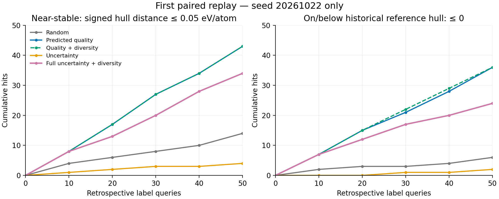

# Phase 3 execution report

**Phase 3 completed the frozen initial predictor, the first five-policy replay and the early generation/selection/DFT workflow.** In seed 20261022, the full acquisition method retrieved 34 near-stable records in 50 queries, compared with 43 for quality ranking. The early CaMg2O3 cohort produced no candidate satisfying its predeclared six-atom gate, so the predetermined known-MgO control was CHGNet-relaxed and validated with fresh QE calculations. It recovered the known MgO reference prototype at indistinguishable energy within the recorded numerical resolution.

This report separates retrospective WBM label retrieval, generated-structure checks, CHGNet screening and fresh DFT. No new stable material or general acquisition advantage has been established. The governing settings remain in the [frozen Phase 2 protocol](../config/phase2_protocol.json).

## Frozen initial model and label boundaries

The initial ensemble used 2,000 training structures and 400 calibration structures from whole, disjoint chemical systems. Its five outer-bootstrap ExtraTrees members each contain 128 trees, use minimum leaf size two and run with two CPU workers. All 408 descriptors derive from initial geometry and composition. Diversity uses the first 150 descriptors, normalized once from the initial training set. Calibration/evaluation structures are not diversity anchors.

The target remains the released WBM **signed distance to the fixed historical MP hull**, in eV/atom. Near-stable hits use an inclusive 0.05 eV/atom threshold; on/below-reference-hull hits use an inclusive zero threshold. These are existing DFT labels revealed retrospectively, not fresh DFT calculations. The withheld chemistry tests new element combinations with individually observed elements; it does not establish OOD behavior relative to CrystalFormer's pretraining data.

The immutable fresh selector was committed at **2026-10-22 01:43:52 Singapore time**, before any replay query or evaluation-label access. It contains the initial heads, calibration, training/calibration IDs, initial diversity anchors, normalization and source/data/protocol hashes. Its SHA256 is `b7cbae9c54cdc486bac5d9de743f3e75e2322bf7bf01a3f03f7b92acfa3e8359`. No adapted replay head replaced it. Initial fitting/calibration took **9.44 seconds**; the empirical residual multiplier was **q = 6.61457**, using rank 361 of 400 and a disagreement floor of 0.01 eV/atom.

Files: [immutable model manifest](../artifacts/phase3/models/fresh_selector_seed_20261022.manifest.json), [initial fit audit](../artifacts/phase3/model_logs/initial_fit_audit.json), [shared prediction code](../research_models.py).

## First paired replay: seed 20261022

Every policy received the same 2,400 initial labels and the same 2,000-row hidden pool. Each selected five batches of ten, refitting only on initial training plus that policy's own revealed records. Calibration reused the fixed 400 rows; normalization remained fixed. The full policy retained its seven conservative and three optimistic choices per batch. No coefficients or hyperparameters were changed after observing outcomes.

| Policy | Near-stable hits / 50 | Precision | Reference-hull hits | Queried chemical systems | Final evaluation MAE, eV/atom | Final nominal-90% interval coverage |
|---|---:|---:|---:|---:|---:|---:|
| Random | 14 | 28% | 6 | 48 | 0.10515 | 86.31% |
| Quality | 43 | 86% | 36 | 28 | 0.10574 | 87.16% |
| Quality plus diversity | 43 | 86% | 36 | 27 | 0.10562 | 86.89% |
| Uncertainty only | 4 | 8% | 2 | 44 | 0.10495 | 85.66% |
| Full method | 34 | 68% | 24 | 43 | 0.10501 | 86.81% |



[PDF version of the figure](../artifacts/phase3/figures/first_seed_acquisition.pdf).

The full method covered more chemical systems than quality ranking but found nine fewer near-stable records. Uncertainty-only sampling also performed poorly on immediate retrieval. These observations describe one fixed seed and budget; they do not resolve performance across the other four paired seeds or establish a general exploration/exploitation trade-off. Those runs must retain the frozen settings rather than retuning to reverse this result.

The separate evaluator used the **same 3,418 untouched records** for every policy. Initial held-out performance was:

| Metric | Initial ensemble |
|---|---:|
| MAE | 0.10644 eV/atom |
| RMSE | 0.29933 eV/atom |
| Spearman correlation: disagreement versus absolute error | 0.34824 |
| Nominal-90% interval empirical coverage | 87.04% |
| Mean interval width | 0.51002 eV/atom |

The intervals under-covered relative to their nominal 90% level. Chemical-system shift and adaptive reuse of calibration support an empirical reliability assessment, not an arbitrary-OOD coverage guarantee. Small final MAE differences should not be interpreted as established advantages from this single run.

The replay took **277.22 seconds** after loading the initial snapshot. Initial plus adapted fitting/calibration consumed **242.23 seconds** across 26 model snapshots. All **250 policy-query events** are retained; IDs may overlap across policies, while each policy's 50 queries are unique.

The independent audit reproduced all 25 batch selections from saved pre-reveal predictions, checked 125 adapted bootstrap plans and verified training/calibration boundaries and model/decision/reveal hashes. All decisions were serialized before labels were revealed. The evaluator decoded its labels only after every policy finished; its outputs could not influence a fit, acquisition or stopping decision. The initial snapshot remained unchanged. Floating-point differences from parallel tree summation were approximately 1.8e-15 in an independent calibration recheck; stored predictions define the executed decisions.

Files: [query results](../artifacts/phase3/replay/seed_20261022/summary.json), [held-out metrics](../artifacts/phase3/replay/seed_20261022/evaluation_summary.json), [250-event query journal](../artifacts/phase3/replay/seed_20261022/query_journal.csv), [independent audit](../artifacts/phase3/replay/seed_20261022/audit_report.json).

## Early CaMg2O3 generation and the zero-candidate result

The frozen early cohort requested **eight CaMg2O3 structures in SG2**, in two batches of four, using the verified CrystalFormer source/checkpoint and fixed seed schedule. Its primary eligibility gate required the exact evaluated cell **Ca1 Mg2 O3: six atoms**, minimum periodic separation at least 0.75 angstrom and the shared geometry checks. Sampling used temperature 1.0 and top-p 1.0; the evaluated-cell cap remained 20 atoms.

All eight generated structures measured as SG2, but **zero of eight satisfied the exact six-atom gate**. Two outputs, attempts 005 and 006, had the correct reduced formula and acceptable geometry but contained **Ca2 Mg4 O6, twelve atoms**. They remained excluded under the predeclared executed-cell rule. A third reduced-formula match, attempt 007, contained **36 atoms** and a minimum periodic separation of approximately **0.574 angstrom**, failing both the cell-size and distance limits. The other five outputs had different reduced compositions. The two twelve-atom outputs are useful diagnostics, not retrospectively admitted primary candidates or evidence of instability.

The first batch was saved before a logging exception interrupted the original run. Its raw outputs were retained and verified without resampling. A separately authorized continuation emitted only the originally planned second batch, preserving its seed and attempt IDs. Consequently **eight actual model draws consumed twelve charged Phase 3 generation slots**: the original eight-slot reservation plus four continuation slots. Four un-emitted engineering slots remain conservatively charged. The first call's exact sampling timer was lost; its recorded upper bound is 27.21 seconds. The continuation's first call took 15.64 seconds including JIT/cache handling, so this cohort does not provide a clean steady-state throughput comparison.

Files: [all attempts and rejection reasons](../artifacts/phase3/generation/early_CaMg2O3/summary.json), [independent generation audit](../artifacts/phase3/generation/early_CaMg2O3/audit.json), [frozen empty primary selection](../artifacts/phase3/selection/early_pool_selection.json). No additional CaMg2O3 draws were used to replace these failures, and no matched SG-versus-P1 conclusion follows from this one-arm cohort.

## Predetermined MgO fallback and CHGNet handoff

The zero-candidate outcome triggered the existing fallback **phase1_mgo_attempt_000**, an eight-atom Mg4O4 control fixed before Phase 3 outcomes. It was not selected by its CHGNet or DFT energy. The initial surrogate predicted 0.18377 eV/atom with calibrated half-width 0.64106 eV/atom; these are screening estimates against the historical WBM target, not a fresh stability determination.

CHGNet model 0.3.0 relaxed the control on CUDA in **18 optimizer steps**, with **1.39 seconds** inside relaxation and **6.43 seconds** charged subprocess walltime. It converged to SG225, retained Mg4O4, and passed the geometry/workload gates. The final atomic force norm was approximately 5.55e-6 eV/angstrom; the optimizer's combined filter maximum was 0.04649 eV/angstrom. Its reported energy was **-6.31377 eV/atom**, a CHGNet screening value that must not be subtracted from a QE or MP hull. This used one explicitly allocated contingency launch and produced one eligible structure in the fixed QE queue.

Files: [fallback decision](../artifacts/phase3/selection/fallback_decision.json), [CHGNet result](../artifacts/phase3/chgnet/phase1_mgo_attempt_000/result.json), [ordered DFT handoff](../artifacts/phase3/selection/DFT_handoff.json).

## Fresh QE assessment: validated known-MgO recovery

All **14 Phase 3 QE jobs** have finished, using **1,205.09 seconds (20.08 minutes)** of cumulative job walltime. The queue included original-source-cell MgO/CaO reference relaxations, cutoff/k-point probes, a refined MgO relaxation and its continuation, the eight-atom generated MgO control, and four final-geometry probes. No primary CaMg2O3 candidate entered QE. CaO remains a starting-setting calculation, with further refinement deferred because there is no primary-composition comparison.

The accepted MgO settings are **PBE, 90/720 Ry wavefunction/density cutoffs and reciprocal spacing 0.35 inverse angstrom**, using the same checksum-identified Mg/O pseudopotentials. The two-atom reference uses an 8x8x8 mesh; the eight-atom generated cell uses 5x5x5. Jobs run one at a time with four CPU threads, `nosym` and `noinv`, releasing imposed atomic/cell symmetry. The accepted continuation uses a stricter internal pressure target of 0.1 kbar; the frozen external full-stress/pressure acceptance limit remains 0.5 kbar.

| Final accepted result | Two-atom MgO reference | Eight-atom generated MgO control |
|---|---:|---:|
| Energy, eV/atom | -513.8780439713 | -513.8780495046 |
| Maximum force-vector norm, eV/angstrom | 3.59e-6 | 9.86e-6 |
| Maximum absolute residual stress component, kbar | 0.03702 | 0.04264 |
| Final electronic residual, Ry | 5.38e-9 | 7.85e-12 |
| Final-geometry 75-to-90 Ry energy shift, meV/atom | 0.93387 | 0.93163 |
| Final-geometry 0.45-to-0.35 spacing energy shift, meV/atom | 0.19141 | 0.03391 |

Both final relaxations passed electronic convergence, ionic completion, maximum force-vector norm <=0.0205688269904 eV/angstrom, and pressure/full-stress limits. All four energy-sensitivity checks pass the frozen 5 meV/atom target at the accepted final geometries. These finite checks establish the stated numerical resolution, not a rigorous error bound. The generated control's relaxation took **570.36 seconds**, including QE's final rebuilt-cell electronic calculation; its electronic steps converged despite retained Davidson warnings.

The initial cutoff study had a 60-to-75 Ry shift of **5.98 meV/atom**, which required extending to 90 Ry. An earlier 90 Ry reference relaxation failed the independent final stress check at **0.733 kbar** and remains recorded as rejected for stationarity. Its continuation passed at 0.037 kbar. This is why QE's ionic completion message alone was insufficient. Final 75 Ry probes are electronic sensitivity tests; their stress need not pass the accepted 90 Ry geometry criterion. The parser converts XML Hartree atomic units explicitly and checks the XML energy against stdout. [QE XML unit convention](https://lists.quantum-espresso.org/pipermail/users/2017-July/038778.html)

The raw generated-minus-reference difference is **-0.00553 meV/atom**, far below the observed numerical sensitivity. Primitive/supercell-aware structure matching without rescaling confirms the same prototype, with both structures measuring **SG225**. Their original eight- and two-atom execution cells remain intact. This is **numerically indistinguishable known-control recovery**, with no resolved energy advantage. No symmetry-breaking perturbation or phonon test was performed. No complete competition hull, new material, finite-temperature stability or acquisition-policy benefit follows from this control.

Files: [QE summary and numerical validation](../artifacts/phase3/qe/summary.json), [all-job hash audit](../artifacts/phase3/qe/audit.json), [QE event journal](../artifacts/phase3/qe/events.jsonl). All job inputs, outputs, final structures, XML data, settings, pseudopotential hashes, executable hash and pre-dispatch reservations are retained.

## Budgets and remaining Phase 4 work

The canonical ledger charges **24 of 128 generation slots**, leaving **104**: twelve pre-Phase-3 charges and twelve Phase 3 charges, including the four un-emitted engineering slots. CHGNet has **9 of 40 launches charged**, leaving **31**; cumulative charged CHGNet walltime is **30.29 seconds**, leaving 14,369.71 seconds against the four-hour ceiling. QE has charged **1,207.19 seconds including Phase 1**, leaving **20,392.81 seconds (5 hours 39 minutes 53 seconds)** against the six-hour ceiling. No numerical reservation remains active. All failures, retries and reservations remain part of the [canonical cumulative ledger](../artifacts/budget_ledger.json).

The four engineering charges increase the default full-program total from 84 to **88 charged structure slots**, leaving 40 slots of headroom if the remaining prescribed attempts finish without further overhead. The conditional stretch would consume 104 slots, leaving 24. These accounting estimates do not change primary sampling denominators or authorize extra draws automatically.

The remaining Phase 4 experimental work is:

1. Run the other four predeclared paired replay seeds, **20261023-20261026**, with the unchanged model, acquisition and evaluation rules. Retain this first-seed negative finding.
2. Complete the matched symmetry arms for the fixed MgO and rutile controls, preserving the exact evaluated cells, balanced quotas, primary attempted-sample denominators and any eligible Phase 1 reuse.
3. Generate the remaining five default new-to-reference formulas: **SnSrO2, BaSnO2, Mg2SrO3, Ca2ZnO3 and Ca2SrO3**. Preserve the failed early CaMg2O3 cohort, use the same immutable fresh selector and remain within the shared ledgers.

The current artifacts support a completed first retrospective experiment, a measured exact-cell generation failure and a numerically checked known-control DFT recovery. Wider acquisition conclusions, a matched symmetry result and the remaining formula coverage await their planned runs. The zero-candidate result applies to this frozen eight-draw exact-cell cohort; it does not establish a general generator failure.

## Saved evidence and reproduction

Audit the completed Phase 3 package without fitting predictors, generating structures, relaxing atoms or launching QE:

```powershell
.envs/analysis/Scripts/python.exe scripts/phase3_finalize.py
```

The [readiness record](../artifacts/phase3/readiness.json), [consolidated audit](../artifacts/phase3/audit.json) and [artifact manifest](../artifacts/phase3/manifest.json) record the final checks and remaining work. The finalizer refreshes these audit snapshots and the canonical budget from existing events. Preserve the frozen model, protocol, splits, query history and every failed attempt.

Execution entry points are `scripts/phase3_replay.py`, `scripts/phase3_generate.py`, `scripts/phase3_candidates.py` and `scripts/phase3_qe.py`. Replay outputs are immutable unless explicitly resumed; numerical jobs use unique IDs and pre-dispatch budget reservations. Generation's original and corrected executed scripts are retained with the failed and continuation reservations. The Phase 3 QE wrapper supports the small Ca/Mg oxide scope; elemental metals, molecular oxygen, inherited smearing and unreviewed spin settings require a later supported workflow. No such reference job was silently substituted with an insulating calculation.

The atomic reservation layer charges attempts before dispatch, holds the full watchdog allowance while a job is active, and charges actual subprocess walltime on completion. Its ten isolated guard checks include exhausted caps, failed launches, duplicate IDs and competing processes. Audit fixtures consume no real generation, CHGNet or QE budget. All numerical work remains subject to the original **22 October 2026, 18:24:44 Singapore time** hard stop.
