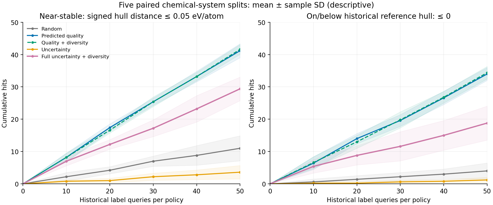
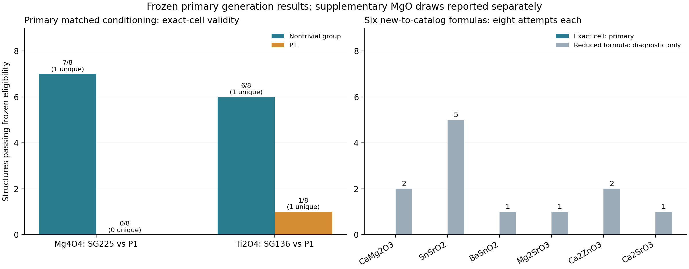

# Phase 4 execution report

**Phase 4 is complete: all five paired replay seeds, the matched primary symmetry cohorts, all six default formula cohorts, one bounded supplementary MgO pair and compatible CaO reference refinement are executed.** The full acquisition policy found fewer near-stable records than quality ranking in 5 of five seeds. No new-formula output passed the frozen exact-cell gate; the resulting fresh shortlist is empty. All failures and negative findings remain in the evidence.

## Five-seed acquisition experiment

Each seed uses 2,000 initial training labels, 400 calibration labels and a hidden 2,000-row pool, with complete chemical systems kept disjoint within that seed. Every policy receives the same starting resources and five batches of ten additional labels. The untouched evaluation cohort has 3,418 rows per seed. The five fixed ExtraTrees bootstrap members, 408 initial-only descriptors, uncertainty floor, residual calibration, diversity normalization, acquisition coefficients and tie-breaking remain unchanged from the [frozen Phase 2 protocol](../config/phase2_protocol.json).

Phase 4 added **1,000 retrospective query events** across the four remaining seeds. Together with the unchanged Phase 3 run, there are **1,250 events**, covering 720 distinct pool IDs. Events can reuse historical records across policies or splits; they are not fresh DFT calculations. The 2,400 initial labels per seed are a separate shared resource.

Near-stable hits at 50 queries, using signed historical WBM hull distance <=0.05 eV/atom:

| Seed | Random | Quality | Quality + diversity | Uncertainty | Full | Full minus quality |
|---|---|---|---|---|---|---|
| 20261022 | 14 | 43 | 43 | 4 | 34 | -9 |
| 20261023 | 15 | 40 | 40 | 6 | 32 | -8 |
| 20261024 | 12 | 44 | 42 | 2 | 25 | -19 |
| 20261025 | 6 | 39 | 40 | 5 | 29 | -10 |
| 20261026 | 8 | 40 | 43 | 1 | 27 | -13 |

| Policy | Hits: mean +/- sample SD | Mean precision | Mean on/below reference hull | Mean chemical systems queried |
|---|---|---|---|---|
| Random | 11.0 +/- 3.87 | 22.0% | 4.0 | 46.6 |
| Quality | 41.2 +/- 2.17 | 82.4% | 34.0 | 32.8 |
| Quality + diversity | 41.6 +/- 1.52 | 83.2% | 34.4 | 33.4 |
| Uncertainty | 3.6 +/- 2.07 | 7.2% | 1.2 | 44.6 |
| Full | 29.4 +/- 3.65 | 58.8% | 18.8 | 42.2 |

The paired full-minus-quality difference averages **-11.8 hits**, with sample SD **4.44**; wins/ties/losses are **0/0/5**. This supports a negative result for the frozen full policy under this 50-query benchmark. It does not show that uncertainty-aware acquisition generally fails. These are five overlapping splits of one dataset; means and sample SD are descriptive, without a significance or independent-dataset claim. No seed, policy, coefficient or stopping rule was changed to reverse the outcome.



All decisions were committed before their selected labels were revealed. Each policy refit on only its initial training set plus its own queries, using the fixed calibration set. Evaluation labels entered a separate evaluator after all five policies for that seed finished; metrics never returned to acquisition. Other seeds' partitions can overlap, but models and revealed labels are not shared between seeds. The original seed-20261022 initial snapshot remains the sole fresh-candidate selector, unchanged before and after these runs.

Mean untouched-evaluation metrics across seeds (initial model or the policy endpoint at 50 queries):

| Model | MAE, eV/atom | RMSE, eV/atom | Empirical coverage (nominal 90%) | Mean interval width, eV/atom |
|---|---|---|---|---|
| Initial shared | 0.10525 | 0.29874 | 89.99% | 0.5646 |
| Quality | 0.10496 | 0.29892 | 89.38% | 0.5419 |
| Full | 0.10464 | 0.29826 | 88.88% | 0.5282 |

Intervals are empirically calibrated under chemical-system shift, with no arbitrary-OOD coverage guarantee. The [aggregate metrics](../artifacts/phase4/replay/aggregate_summary.json) and [all endpoint metrics](../artifacts/phase4/replay/per_seed_evaluation_metrics.csv) retain every policy's errors, uncertainty/error association, coverage and widths. Artifact audits reproduced all 125 batch decisions, 625 adapted plus 25 initial bootstrap plans, 130 calibration values and 130 model/evaluation snapshots. Phase 4 added 104 ensemble snapshots. New-seed fitting/calibration used **1123.8 seconds**; measured replay invocations used **1337.7 seconds**. These are wall durations excluding imports/audits, not new DFT cost.

## Matched primary symmetry sampling

The four primary arms each retain their first eight attempts. Phase 1 MgO SG225 is reused with source/hash proof, including its failed attempt; the other three arms ran in Phase 4. Checkpoint, temperature, top-p, eligibility, exact evaluated cells and deduplication are frozen. Both arms use the same symmetry-aware architecture, so this tests the sampling condition rather than an architecture trained without symmetry.

| Evaluated formula | Requested SG | Exact-cell valid | Valid unique | Reduced composition + geometry diagnostic |
|---|---|---|---|---|
| Mg4O4 | 225 | 7/8 | 1 | 7/8 |
| Mg4O4 | 1 | 0/8 | 0 | 5/8 |
| Ti2O4 | 136 | 6/8 | 1 | 6/8 |
| Ti2O4 | 1 | 1/8 | 1 | 4/8 |

Nontrivial-group conditioning improved raw exact-cell validity for these controls. Unique yield was not uniformly higher: TiO2 yielded one unique structure in each arm. The reduced-composition diagnostic also shows that the evaluated-cell requirement contributes to the contrast. It never replaces the primary exact-cell metric. Eight draws per arm and two known compositions do not establish broad stability, novelty or generator-architecture benefits.



One predeclared supplementary MgO batch added four draws per arm using unused batch index 2, before random relaxation selection. SG225 yielded **4/4 valid**, P1 **1/4**; each combined primary-plus-supplementary pool has one unique structure. The additional attempts remain separate from the primary denominator. This enables one supplemented MgO pair for Phase 5, while TiO2 supports one pair from its primary pools. Neither comparison estimates an energy distribution from several independent structures. No further top-ups were authorized or run.

The [frozen random relaxation plan](../artifacts/phase4/selection/symmetry_relaxation_plan.json) selects equal quotas without surrogate or observed-energy ranking. Four experimental selections are recorded. The MgO SG225 representative matches the prior CHGNet control source and may reuse that calculation only after Phase 5 verifies identical settings/checkpoint; it is not charged a second time as compute. No new symmetry relaxation ran in Phase 4.

## Six proposed compositions and exact-cell bottleneck

The full default pool contains **48 attempts across six formulas**, including the unchanged Phase 3 CaMg2O3 cohort. Composition absence remains scoped to the pinned MP2022 and full WBM catalogs; global novelty and generator-training absence are unproven.

| Formula | Primary exact-cell valid | Reduced composition + basic geometry + <=20 atoms: diagnostic only |
|---|---|---|
| CaMg2O3 | 0/8 | 2/8 |
| SnSrO2 | 0/8 | 5/8 |
| BaSnO2 | 0/8 | 1/8 |
| Mg2SrO3 | 0/8 | 1/8 |
| Ca2ZnO3 | 0/8 | 2/8 |
| Ca2SrO3 | 0/8 | 1/8 |

There are **zero primary-eligible structures**, but **12 diagnostic outputs across all six formulas** match their reduced compositions and pass the basic geometry/20-atom checks in larger cells. These are generated proposals, not stable materials. The exact small evaluated-cell requirement is a practical bottleneck in this run; zero eligible yield does not establish a general inability to generate these compositions or their physical instability. The pinned [sampling code](../vendor/CrystalFormer/crystalformer/src/sample.py) uses composition conditioning and an element-identity mask; our exact expanded-count gate is an additional post-generation filter. The [fresh shortlist](../artifacts/phase4/selection/fresh_shortlist.json) preserves six empty formula entries and the original model hash. No posthoc cell-count admission, reserve substitution, CHGNet energy ranking or replacement draw was used.

The optional composition stretch is **disabled**. MgO P1 has zero valid unique primary outputs and none of the six default formulas has an exact-cell eligible structure. The core adequacy gates therefore fail; remaining generation capacity alone does not enable additional formulas. The [gate record](../artifacts/phase4/gates/composition_stretch.json) retains the budget and clock checks. A broader evaluated-cell follow-up would need its own protocol and must remain separate from these completed primary outcomes.

## Fresh DFT reference work

Phase 4 ran **three genuine QE jobs**, totaling **451.29 seconds (7.52 minutes)**: CaO variable-cell relaxation and two final-geometry sensitivity probes. Accepted CaO uses PBE, the frozen pseudopotentials, 90/720 Ry and 0.35 inverse-angstrom spacing (7x7x7 mesh), four threads and no imposed symmetry. Final maximum force is **4.76e-05 eV/angstrom**, full-stress maximum **0.05318 kbar**, with converged final electronic and ionic flags. The cutoff and k-point shifts are **0.9796** and **0.0488 meV/atom**, both below 5. The 75 Ry probe's nonstationary stress remains identified; it is a sensitivity calculation, while the accepted 90 Ry geometry passes all stationarity checks.

The [compatible oxide anchors](../artifacts/phase4/qe/oxide_reaction_anchors.json) combine accepted CaO and the reused accepted Phase 3 MgO reference. Their shared functional, O pseudopotential, cutoffs and spacing are verified. The CaO + 2MgO weighted product energy is **-607.632128522 eV/atom**. No eligible primary CaMg2O3 candidate exists to subtract, so no candidate reaction energy is reported. Of 161 frozen reference IDs, **159 remain uncomputed**. These two anchors do not establish a complete hull or a new stable material. Metal, O2 and spin-ambiguous references remain outside this completed queue.

## Budgets, audit and Phase 5 handoff

Phase 4 made **72 actual new CrystalFormer draws**: 64 primary plus eight supplementary. Across all phases there are 88 actual model draws, four prepared prototype candidates and four un-emitted engineering charges, totaling **96/128 charged structure slots**, with **32 remaining**. The four Phase 3 engineering charges remain intact; Phase 4 introduced no generation retry overhead. CHGNet remains **9/40 charged launches**, leaving **31**, with 14369.71 seconds remaining. Cumulative QE is **1658.48 seconds**, leaving **19941.52 seconds**. Per-lane times can overlap and should not be summed into elapsed project time. All caps and the **22 October 2026, 18:24:44 Singapore time** numerical stop remain binding. No numerical job remains active.

Primary generation passed 1,629 artifact checks; the supplementary audit passed 141 and the QE audit 83. The consolidated [Phase 4 audit](../artifacts/phase4/audit.json), [manifest](../artifacts/phase4/manifest.json) and [readiness record](../artifacts/phase4/readiness.json) bind the lane evidence and final handoff. Auditing did not fit models, draw candidates, relax structures or run QE. A CIF roundtrip audit disabled parser fractional-coordinate idealization to compare stored coordinates accurately; original CIF/JSON/raw outputs and eligibility were unchanged.

Audit saved results without launching further numerical work:

```powershell
.envs/analysis/Scripts/python.exe scripts/phase4_finalize.py
```

Phase 5 can execute the frozen balanced symmetry selections, validate the four already-prepared prototype baselines and the predeclared reference subset, and continue only supported, bounded DFT work. The primary new-formula shortlist contributes zero candidates. Keep supplemented MgO and primary TiO2 energy comparisons distinct, preserve failures and avoid comparing QE with WBM/CHGNet energy conventions. No newly stable material, complete hull or symmetry-related energy advantage has been established.
