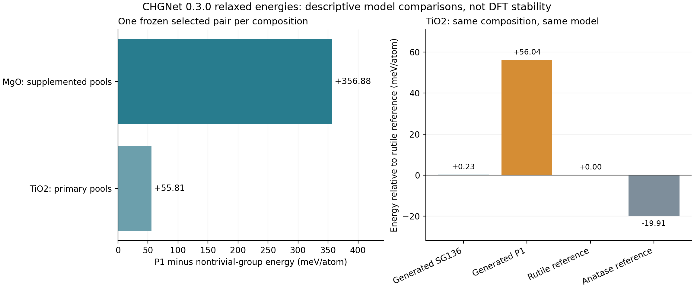

# Phase 5: model relaxations and known-control robustness

Generated from saved results at 2026-10-22T02:35:44.455937+00:00. The scientific protocol, fresh selector, exact-cell eligibility gate and original DFT queue remain unchanged.

## Outcome and evidence level

All **11/11 selected CHGNet calculations converged**: four symmetry selections, four predeclared prototype baselines and three eligible same-composition references. This required 10 new launches and one verified cached calculation, charging 128.722442 new subprocess seconds. No new generator draws, acquisition fits or replay queries were performed.

The selected symmetry-conditioned outputs have lower CHGNet energies than their P1 partners at both control compositions. Each comparison contains only one structure per arm; MgO includes a separately labelled supplementary sampling batch. These are descriptive model results, insufficient to estimate an energy distribution or establish an architectural causal effect. No DFT symmetry-pair comparison was conducted.

The fresh transformer shortlist remains empty because none of the 48 new-formula draws passed the frozen exact-cell gate. Larger-cell diagnostic outputs remain excluded. The four prototype baselines form a separate predeclared comparison set; their CHGNet results do not promote them into the original transformer DFT queue. No new stable material or complete compatible hull has been established.

## Frozen execution and selection

- The [CHGNet plan](../artifacts/phase5/chgnet/plan.json) and [QE queue](../artifacts/phase5/qe/queue_plan.json) were saved before their respective first dispatches. The [root execution record](../artifacts/phase5/execution_plan.json) consolidates those decisions at 02:19 UTC (10:19 Singapore time), after the first lane jobs had started; the timestamped lane plans define the settings and permitted jobs.
- Symmetry selections are exactly the random within-arm IDs fixed in [Phase 4](../artifacts/phase4/selection/symmetry_relaxation_plan.json). Equal quotas are one per arm; there are no energy-dependent replacements.
- All runs use CHGNet package 0.4.2, checkpoint 0.3.0 (SHA256 d14ab7c0f093efe64b60a7bcd540bca10e74fb7f46c86108a079af60524659d1), CUDA, two Torch threads, seed 20261022, FIRE, at most 200 steps, and a 0.05 eV/angstrom Frechet cell-filter force criterion. Atomic coordinates and cell can relax without imposed space-group constraints.
- The selected eight-atom MgO nontrivial-arm result reuses the identical Phase 3 source/checkpoint/worker/settings. Its original compute charge remains recorded once; reuse adds no launch or walltime. The other ten selections were launched and charged once each.
- Saved total model energies are divided by each actual cell atom count. CHGNet convergence uses its cell-filter criterion; QE uses separate force and full-stress acceptance criteria.

## Balanced symmetry comparisons

| Control | Sampling scope | Nontrivial / P1 final SG | CHGNet P1 minus nontrivial (meV/atom) | Converged per arm |
|---|---|---|---:|---|
| mgo_rocksalt | Supplementary primary-plus-top-up pool | 225 / 1 | 356.879234 | 1 / 1 |
| tio2_rutile | Primary first-eight pool | 136 / 1 | 55.806478 | 1 / 1 |

The nontrivial MgO and TiO2 structures match the known rocksalt and rutile reference structures, respectively, under the saved StructureMatcher settings. Each relaxed P1 partner differs from its nontrivial partner. Failure to match this small reference subset does not establish global structural novelty.

Primary generation denominators remain 7/8 versus 0/8 for MgO and 6/8 versus 1/8 for TiO2. MgO's balanced relaxation uses the separately labelled four-attempt-per-arm supplement; it does not revise the primary validity result. Selected unique pools have one structure each, so the random selection has no residual choice within these pools.



[Export figure as PDF](../artifacts/phase5/figures/within_composition_energies.pdf). The figure reports CHGNet predictions only.

## Complete model-relaxation ledger

| Selection | Role | Actual atoms | Energy (eV/atom) | FIRE steps | Final filter force (eV/angstrom) | Final SG | Compute |
|---|---|---:|---:|---:|---:|---:|---|
| phase1_mgo_attempt_000 | symmetry | 8 | -6.313771248 | 18 | 0.046494 | 225 | Cached |
| phase4_supplementary_mgo_rocksalt_p1_attempt_010 | symmetry | 8 | -5.956892014 | 121 | 0.049226 | 1 | New |
| phase4_tio2_rutile_nontrivial_attempt_000 | symmetry | 6 | -9.388800303 | 19 | 0.048491 | 136 | New |
| phase4_tio2_rutile_p1_attempt_000 | symmetry | 6 | -9.332993825 | 107 | 0.040247 | 1 | New |
| prototype_SnSrO2 | prototype | 4 | -6.041627884 | 5 | 0.042908 | 123 | New |
| prototype_BaSnO2 | prototype | 4 | -5.952028751 | 5 | 0.045025 | 123 | New |
| prototype_CaMg2O3 | prototype | 6 | -6.384627024 | 37 | 0.047524 | 164 | New |
| prototype_Mg2SrO3 | prototype | 6 | -6.140673955 | 36 | 0.041220 | 164 | New |
| reference_rocksalt | same_composition_reference | 8 | -6.313931942 | 0 | 0.001337 | 225 | New |
| reference_rutile | same_composition_reference | 6 | -9.389032364 | 0 | 0.042159 | 136 | New |
| reference_anatase | same_composition_reference | 12 | -9.408941269 | 4 | 0.044574 | 141 | New |

All four prototype cells preserve their original formula and cell counts (4, 4, 6 and 6 atoms). They were already charged as prepared candidates in Phase 2; relaxation does not create new generation charges. Each formula has only one relaxed prototype, so no prototype polymorph ranking is available. Absolute model energies across these different chemical compositions cannot establish relative stability. The empty transformer shortlist prevents a same-formula generated-versus-prototype energy comparison.

Rocksalt and rutile reference geometries already satisfy the model criterion at step zero. Their evaluation still loads the model, checks forces/stress and consumes a launch and whole subprocess walltime. Anatase converges after four steps. Brookite's predeclared 24-atom conventional cell remains excluded by the 20-atom reference gate, leaving its allocated slot unused without a substitute.

Within TiO2, CHGNet places anatase **19.908905 meV/atom below rutile**. The generated SG136 output is 0.232061 meV/atom above the rutile reference and 20.140966 meV/atom above anatase. Thus the rutile-conditioned output is not the lowest-energy TiO2 structure even in this limited model reference set. This is not a DFT ground-state ranking.

Raw worker `DFT_eligible` fields describe geometry/workload gates. Every Phase 5 summary row explicitly records `DFT_dispatch_authorized: false`; those fields neither confer queue admission nor label stability. The known MgO control had already entered QE under the earlier fallback selection.

## Known-MgO DFT perturbation check

The predeclared check starts from the accepted eight-atom Phase 3 DFT geometry. NumPy seed 260022 draws one normalized 0.01-angstrom displacement per atom and one symmetric strain with maximum absolute principal strain 0.005. The geometry and random arrays were saved before dispatch in the [perturbation manifest](../artifacts/phase5/qe/perturbation/manifest.json). Its initial detected space group changes from 225 to 1 at 0.001-angstrom tolerance.

The queue permits one 90/720 Ry variable-cell relaxation with 0.35 reciprocal-space spacing, plus one same-setting continuation only if electronic convergence is accepted but independent stationarity is insufficient. If a stationary geometry is obtained, two fixed-final-geometry probes use 75/600 Ry at spacing 0.35 and 90/720 Ry at spacing 0.45. All jobs retain the same PBE pseudopotential files, four threads, fixed occupations, nspin=1, nosym/noinv and released atomic/cell degrees of freedom. No failed electronic job is replaced with another target.

QE's internal pressure target is 0.1 kbar. Independent external acceptance requires electronic error <=1e-8 Ry, maximum atomic force-vector norm <=0.0205688269904 eV/angstrom, absolute pressure and every full-stress component <=0.5 kbar, and an ionic-convergence indication. Final-geometry cutoff and k-point shifts must each be <=5 meV/atom; actual k meshes must differ for the k-point test. The entire allowed queue has a 2,520-second watchdog ceiling within a separate 3,600-second Phase 5 subcap, the cumulative six-hour QE cap and the original hard stop.

Executed **1 Phase 5 QE jobs**, charging **900.438514 seconds**. Perturbation final-geometry numerical checks passed: **False**. Validation incomplete: **True**.

The bounded perturbation check did not obtain all required accepted final-geometry evidence. Its outputs and compute charges are retained, and no accepted finite energy comparison or successful recovery is inferred. This does not invalidate the previously accepted unperturbed control; the additional robustness result remains incomplete.

In this run, QE reached its **900-second internal time limit** during the ninth SCF call, after eight completed electronic calculations and seven BFGS steps. The executable returned code zero and printed `JOB DONE`, but its final electronic and ionic states were not converged and terminal force/stress XML fields were unavailable. The saved parser diagnostic records the missing terminal data. The driver therefore allowed **no continuation and no sensitivity probes**: the conditional continuation required accepted terminal SCF convergence. This is an incomplete bounded calculation, not evidence of physical instability or an accepted energy ordering.

| Final-geometry check | Job | Absolute energy shift (meV/atom) | SCF accepted | Same final geometry | Within 5 meV/atom |
|---|---|---:|---|---|---|
| Not dispatched | No accepted stationary parent | Unavailable | Unavailable | Unavailable | Unavailable |

A single perturbation trajectory probes local relaxation behavior only. It is not a phonon calculation, a proof of a local minimum or dynamical stability, a new material, or a full competing-phase hull calculation.

## Reference completeness and discovery limits

Compatible accepted fresh QE source-reference coverage remains **2/161 Ca-Mg-O entries** (MgO and CaO), leaving 159 incomplete; the Mg-O fallback has **1/57 entries**, leaving 56 incomplete. Recomputing a perturbed MgO geometry adds no new reference ID. The three CHGNet references are a separate model lane and do not increase QE reference coverage. Elemental endpoints, oxygen treatment, spin/occupation review and all other missing competitors remain necessary before any unrestricted stability claim.

No transformer CaMg2O3 candidate reached the frozen exact-cell gate; the valid six-atom prototype CaMg2O3 is a different method baseline. It has not been substituted after seeing failures or model energies. The prior compatible CaO+2MgO anchors alone cannot establish a complete Ca-Mg-O hull or stability of an unevaluated candidate.

## Budget closure

| Resource | Cumulative charged | Remaining | Original ceiling |
|---|---:|---:|---:|
| Structures | 96 | 32 | 128 |
| CHGNet launches | 19 | 21 | 40 |
| CHGNet job walltime (seconds) | 159.011885 | 14240.988115 | 14,400 |
| QE job walltime (seconds) | 2558.920392 | 19041.079608 | 21,600 |

The 96 structure charges comprise 80 primary CrystalFormer draws, eight supplementary draws, four prepared prototype candidates and four un-emitted engineering charges. CHGNet's cumulative 19 charges include four historical pre-model launcher rejections and 15 actual relaxation launches. Cached experimental reuse creates no second compute charge. Failed jobs and retries remain in the ledgers. All lane reservations are closed. Numerical work must still stop by **22 October 2026, 18:24:44 Singapore time**; remaining capacity does not reopen failed scope gates.

## Verification and Phase 6 handoff

The [CHGNet saved-trajectory audit](../artifacts/phase5/chgnet/audit.json) independently checks sources, cache settings, composition, actual cell counts, energy normalization, cell-filter forces and reservations. The [QE audit](../artifacts/phase5/qe/audit.json) checks deterministic perturbation construction, XML energy/force/full-stress acceptance, final-geometry sensitivities and legacy/canonical ledger reconciliation. These integrity audits can pass while a bounded scientific experiment is inconclusive.

The [consolidated Phase 5 audit](../artifacts/phase5/audit.json), [readiness record](../artifacts/phase5/readiness.json) and [hash manifest](../artifacts/phase5/manifest.json) close the phase. Reproduce the consolidated audit from saved evidence without model inference, sampling, relaxation, QE jobs, oracle access or canonical budget writes:

```powershell
.envs/analysis/Scripts/python.exe scripts/phase5_finalize.py
```

Raw lane summaries: [CHGNet](../artifacts/phase5/chgnet/summary.json) and [QE](../artifacts/phase5/qe/summary.json). [Cumulative budget](../artifacts/budget_ledger.json).

Phase 6 must integrate the fixed five-seed acquisition result with these descriptive symmetry comparisons, audit initial-feature/no-label-leakage and catalog scope across streams, and classify all DFT evidence and incomplete competitors. Keep negative acquisition results, primary generation failures and supplementary labels visible. Numerical settings and selection rules remain frozen; any later gate or candidate-method revision requires a separately labelled supplementary experiment. Phases 7 and 8 retain the write-up, demonstration and submission buffer.
